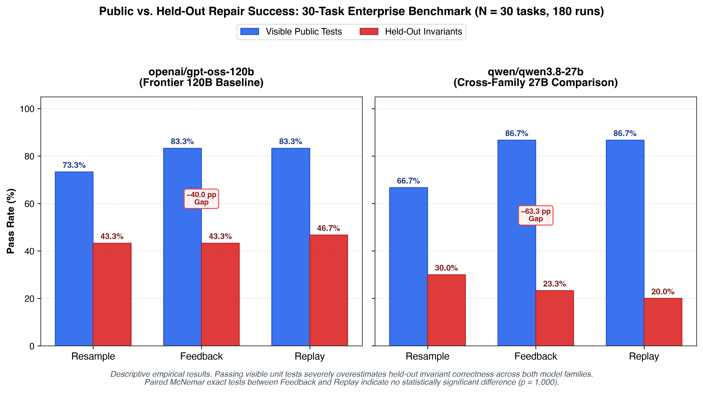

# RETRACE: Evaluating Invariant Overfitting in Autonomous Program Repair

[](https://github.com/tehyalenka/retrace-repair/releases/tag/v1.9.0-research-release)
[](#offline-reproducibility--statistical-verification)
[-purple?style=flat-square)](#headline-empirical-results-180-matrix-evaluations)
[](#quickstart)
[](#research-links)

> **Research Status:** Independent, unpublished research project prepared by Tehya Lenka for Virginia Tech MS CS graduate admissions review.

---

### **Core Research Question**
> **Do visible unit test suites guarantee architectural invariant correctness in autonomous program repair?**

### **One-Sentence Contribution**
RETRACE introduces **physical dual-suite oracle isolation**, **disposable counterfactual replay**, and **cryptographic evidence sealing** to empirically evaluate whether LLM-synthesized patches restore underlying software invariants or merely overfit visible unit tests.

### **Headline Findings (180 Controlled Evaluations across 2 Model Families)**
Across 180 controlled evaluations on 30 enterprise distributed systems tasks evaluated on Groq `openai/gpt-oss-120b` and Alibaba `qwen/qwen3.8-27b`, **public test pass rates (83.3%–86.7%) severely overestimated held-out invariant correctness (20.0%–46.7%)**. In **40.0 percentage points** of tasks on the 120B model (12/30) and **63.3 percentage points** on the 27B model (19/30), agent-generated patches passed all visible tests while silently violating critical production invariants (2PC atomicity, lease fencing, tenant isolation). Paired exact McNemar tests show **no statistically significant difference between iterative feedback and counterfactual replay ($p = 1.000$)**, while replay incurs an **80.5% token premium**.

<p align="center">
  
</p>

---

## Research Links & Access

* **[Read Research Paper (PDF)](paper/manuscript.pdf):** 4-page camera-ready scholarly manuscript with formal methodology, tables, and references.
* **[Extended Research Study (Markdown)](paper/retrace_empirical_study.md):** 3,500+ word detailed empirical report with qualitative patch diffs and cluster breakdowns.
* **[LaTeX Manuscript Source](paper/manuscript.tex) & [BibTeX Citations](paper/references.bib):** IEEE/ACM format, ready for Overleaf compilation.
* **[Frozen Research Release (v1.9.0-research-release)](https://github.com/tehyalenka/retrace-repair/releases/tag/v1.9.0-research-release):** Immutable release tag pinned to commit `75de313`.
* **[Offline Reproducibility Script](scripts/verify_reproducibility.py):** Audit all 130 cryptographically sealed artifacts in < 2 seconds with zero API calls.

---

## Headline Empirical Results (180 Matrix Evaluations)

### 30-Task Enterprise Benchmark Summary

Evaluated across two frontier model families under strict three-arm pairing: stochastic **Resampling** ($T=0.7$), standard iterative **Failure Feedback** ($T=0.0$, up to 2 attempts), and disposable **Counterfactual Replay** ($T=0.0$, best-of-2 speculative branches).

| Strategy Arm | Evaluated Model | Public Pass Rate | Held-Out Pass Rate | Gap (Percentage Points) | Live Calls | Total Tokens | Tokens / Success |
| :--- | :--- | :---: | :---: | :---: | :---: | :---: | :---: |
| **`resample`** | `openai/gpt-oss-120b` | 73.3% (22/30) | 43.3% (13/30) | 30.0 pp | 31 | 90,248 | **6,942.2** |
| | `qwen/qwen3.8-27b` | 66.7% (20/30) | 30.0% (9/30) | 36.7 pp | 36 | 73,285 | **8,142.8** |
| **`feedback`** | `openai/gpt-oss-120b` | **83.3% (25/30)** | 43.3% (13/30) | 40.0 pp | 32 | 123,488 | 9,499.1 |
| | `qwen/qwen3.8-27b` | **86.7% (26/30)** | 23.3% (7/30) | **63.3 pp** | 30 | 79,944 | 11,420.6 |
| **`counterfactual_replay`** | `openai/gpt-oss-120b` | **83.3% (25/30)** | **46.7% (14/30)** | 36.6 pp | 57 | 222,880 | 15,920.0 |
| | `qwen/qwen3.8-27b` | **86.7% (26/30)** | 20.0% (6/30) | **66.7 pp** | 54 | 155,111 | 25,851.8 |

*Note: For Qwen-27B Feedback, the exact fraction is $26/30 - 7/30 = 19/30 = 63.33\%$, reported consistently as $63.3\text{ pp}$.*

### Statistical Significance (Exact Paired McNemar Tests, $N = 30$)

| Paired Comparison | Model | Both Pass | Both Fail | Arm 1 Only | Arm 2 Only | Discordant Pairs | Exact $p$-value | Conclusion |
| :--- | :--- | :---: | :---: | :---: | :---: | :---: | :---: | :--- |
| **Replay vs. Feedback** | GPT-OSS-120B | 10 | 13 | 4 (`Replay`) | 3 (`Feedback`) | 4 / 3 | **$p = 1.000$** | No statistically significant difference |
| **Replay vs. Feedback** | Qwen-27B | 4 | 21 | 2 (`Replay`) | 3 (`Feedback`) | 2 / 3 | **$p = 1.000$** | No statistically significant difference |
| **Feedback vs. Resample**| Qwen-27B | 5 | 19 | 2 (`Feedback`) | 4 (`Resample`) | 2 / 4 | **$p = 0.688$** | Feedback underperforms Resample (traceback hyper-fixation) |

> **Critical Methodological Note:** A non-significant McNemar test ($p = 1.000$) **does not prove that Replay and Feedback are equivalent**. Rather, it demonstrates that at $N = 30$, statistical power is bounded, and the observed differences are indistinguishable from random sampling variance.

---

## Offline Reproducibility & Statistical Verification

To enable admissions reviewers and researchers to verify all claims without incurring API costs or installing external services, RETRACE includes a standalone verification script that audits the cryptographically sealed manifests:

```bash
# Verify 100% of the 130 sealed artifacts and recompute all statistics in < 2 seconds:
python3 scripts/verify_reproducibility.py
```

### What this command verifies:
1. **SHA-256 Envelope Seals:** Validates the cryptographic signatures of `research-enterprise-30/evidence-manifest.json` and `research-enterprise-30-qwen/evidence-manifest.json`.
2. **Individual Artifact Integrity:** Computes SHA-256 hashes for all 130 execution capture traces and live verdict files (0 mismatches).
3. **Data Authenticity:** Recomputes contingency matrices, exact McNemar $p$-values, token totals, and public/held-out pass rates directly from raw execution captures.

---

## RETRACE System Architecture

```
┌────────────────────────────────────────────────────────────────────────┐
│                        RETRACE Repair Architecture                     │
└────────────────────────────────────────────────────────────────────────┘
                                 │
                   [Initial Defect Repository]
                                 │
                 ┌───────────────┴───────────────┐
                 │    Dual-Suite Partitioning    │
                 ▼                               ▼
       [Public Test Suite]             [Held-Out Test Suite]
      (test_public.py in repo)       (heldout.py quarantined)
                 │                               │
                 │   ┌───────────────────────────┤ (NEVER enters workspace)
                 │   │ ZERO Prompt Leakage Proof │
                 │   └───────────────────────────┤
                 ▼                               ▼
     ┌───────────────────────┐         ┌───────────────────┐
     │  Candidate Generation │         │ Research Gate     │
     │  & Local Evaluation   │         │ Independent Audit │
     └───────────┬───────────┘         └─────────▲─────────┘
                 │                               │
     ┌───────────┴───────────┐                   │
     ▼                       ▼                   │
 [Disposable Workspaces] [Public Ranking]        │
 (Isolated Replay Trees) (Pass / Invariant Score)│
                 │                   │           │
                 └─────────┬─────────┘           │
                           ▼                     │
                  [Selected Top Patch] ──────────┘
```

1. **Physical Dual-Suite Isolation:** Visible tests (`test_public.py`) are placed in the agent workspace. The held-out invariant suite (`heldout.py`) and ground-truth solutions are physically quarantined outside the repository tree. Zero prompt leakage is strictly audited before every evaluation.
2. **Disposable Workspace Replication:** Speculative candidates are applied to ephemeral clones in `/tmp`. Intermediate mutations never contaminate the host repository.
3. **Cryptographic Provenance:** All execution states, inputs, and outputs are sealed with SHA-256 manifests.

---

## Quickstart

Requires Python 3.9+ and, for live model evaluations, an API key for Groq, OpenAI, or Gemini.

```bash
# 1. Setup virtual environment
python3 -m venv .venv
source .venv/bin/activate
pip install -e ".[dashboard,test]"

# 2. Run the full unit regression suite (279 passing tests)
python3 -m unittest discover -s tests -p 'test_*.py'

# 3. Verify reproduction of all research findings (offline, 0 API calls)
python3 scripts/verify_reproducibility.py
```

### Running the Repair Agent on a Task

```bash
# Configure API key in .env or shell:
export GROQ_API_KEY="gsk_..."

# Execute repair with disposable candidate replay
retrace agent examples/sample_repo \
  "Make username matching case-insensitive while preserving password validation" \
  --repair-policy counterfactual_replay \
  --attempts 2 \
  --output retrace-result.json
```

---

## Primary Benchmark Design (30 Synthetic Enterprise Tasks)

The primary empirical benchmark evaluates repair policies across **30 synthetic enterprise distributed-systems tasks** grouped into 6 architectural clusters:

| Category / Cluster | Count | Example Tasks | Tested Invariants & Architectural Patterns |
| :--- | :---: | :--- | :--- |
| **Transactional Durability** | 6 | `enterprise_wal_replay`, `enterprise_two_phase_commit`, `enterprise_order_atomicity` | Write-Ahead Log CRC32 recovery, 2PC prepare/commit/abort atomicity, order atomicity rollbacks |
| **Concurrency & CRDTs** | 5 | `enterprise_distributed_lock_lease`, `enterprise_read_write_lock_fair`, `enterprise_crdt_pn_counter` | Monotonic fencing token renewal, fair writer-starvation prevention, state-based PN-Counter join |
| **Fault Tolerance & Sagas** | 6 | `enterprise_dead_letter_retry`, `enterprise_saga_coordinator`, `enterprise_circuit_breaker` | Exponential jitter DLQ routing, reverse saga compensation, three-state circuit breaker |
| **Multi-Tenant Security** | 5 | `enterprise_secret_rotation_vault`, `enterprise_tenant_rate_limiter`, `enterprise_tenant_cache` | Zero-downtime secret rotation grace periods, hierarchical rate limits, tenant key separation |
| **Traffic & Resource Pools** | 5 | `enterprise_sliding_window_rate_limiter`, `enterprise_connection_pool`, `enterprise_adaptive_concurrency_limiter` | Sub-second sliding window log rate limiting, pooled socket leak recovery, Vegas latency throttling |
| **Coordination & Consensus** | 3 | `enterprise_consistent_hash_ring`, `enterprise_leader_epoch_election`, `enterprise_replicated_state_machine` | Virtual node partition churn, monotonic leader epoch fencing, quorum write replication ($W + R > N$) |

---

## Historical Pilot Studies & Baseline Context

Prior to scaling to the primary 30-task benchmark (180 matrix evaluations), two exploratory baselines were established:

### 1. Synthetic Algorithmic Baseline (22 Tasks, `research-full-suite-22`)
A preliminary 22-task suite evaluating single-function algorithmic defects (15 algorithmic tasks + 7 early enterprise prototypes):
* **Results:** Resample: 68.2% (15/22) | Feedback: 68.2% (15/22) | Replay: 68.2% (15/22)
* **Finding:** On simple algorithmic bugs, visible test suites align closely with held-out suites. The severe generalization gap is uniquely pronounced in stateful distributed systems.

### 2. Preliminary Enterprise Pilot (7 Tasks, `research-enterprise-replay`)
An exploratory run on 7 enterprise fixtures:
* Counterfactual Replay exhibited zero observed regressions relative to feedback across the 7 observed tasks.
* **Important Context:** However, scaling to the full 30-task benchmark revealed that Replay and Feedback exhibit symmetric trade-offs (4 vs. 3 discordant outcomes on GPT-OSS-120B, exact McNemar $p = 1.000$). The preliminary pilot result was an exploratory stepping stone, superseded by the frozen 30-task evaluation.

---

## v2.0 Controlled Ablation: Candidate Selection vs. Generation

To investigate why structural AST ranking and invariant contract prompting in v2.0 did not improve held-out correctness on state machines, a pre-specified **$2 \times 2$ factorial candidate-selection ablation** was conducted on the 6 hardest fixtures (`openai/gpt-oss-120b`):

* **Report:** [paper/retrace_controlled_ablation_report.md](paper/retrace_controlled_ablation_report.md)
* **Results Figure:** [docs/retrace_final_ablation_results.png](docs/retrace_final_ablation_results.png)
* **Key Finding:** The AST structural scorer caused **zero selection failures (`SELECTION_FAILURE = 0`)** across 12 candidate pools. Task-level divergence was driven by candidate generation under prompt conditioning (e.g., unlocking single-flight mutexes on `cache_stampede` while encountering exception convention mismatch on `circuit_breaker`). All four factorial arms achieved an identical 50.0% (3/6) held-out pass rate.

---

## Threats to Validity & Methodological Boundaries

1. **Synthetic Enterprise Benchmark Realism:** Fixtures average 200–800 lines of focused systems code. While capturing real distributed concurrency semantics, they do not test multi-million-line monolithic codebases or multi-service network RPCs.
2. **Sample Size and Statistical Power ($N = 30$):** A sample of 30 tasks limits the statistical power of paired tests. Failing to reject the null hypothesis ($p = 1.000$) indicates that differences are indistinguishable from random noise at this sample size, but cannot prove equivalence.
3. **Model & Provider Variation:** Commercial API endpoints introduce potential non-determinism via hardware scheduling and quantization (e.g., FP8). Closed-source reasoning models (e.g., OpenAI o3-mini) may alter invariant retention.
4. **Verifier Oracle Completeness:** Dynamic test execution cannot formally prove the absence of latent race conditions, despite an 81.7% mutation kill score across 142 AST mutations.

---

## Repository Layout

| Directory / File | Purpose |
| :--- | :--- |
| `paper/manuscript.pdf` | **Compiled 4-page camera-ready research manuscript (PDF)** |
| `paper/retrace_empirical_study.md` | **Extended 3,500+ word empirical study (Markdown)** |
| `paper/manuscript.tex` | **Two-column IEEE/ACM LaTeX manuscript source** |
| `paper/references.bib` | **BibTeX bibliography citations** |
| `scripts/verify_reproducibility.py` | **Zero-cost, offline cryptographic evidence verifier** |
| `scripts/generate_results_chart.py` | **Matplotlib script for high-resolution vector charts** |
| `src/retrace/` | Public package API, CLI entrypoint (`retrace agent ...`), and execution coordinator |
| `src/codepilot/` | Internal repair engine, AST analyzers, and strategy implementations |
| `benchmarks/v18/` | Active v1.8 benchmark suite runner, autonomous runner, research gate, and fixtures |
| `research-enterprise-30/` | Sealed evidence for `openai/gpt-oss-120b` (65 artifacts, SHA-256 sealed) |
| `research-enterprise-30-qwen/` | Sealed evidence for `qwen/qwen3.8-27b` (65 artifacts, SHA-256 sealed) |
| `research-controlled-ablation/`| Sealed evidence & telemetry for the 2x2 candidate-selection ablation (12 pools) |
| `tests/` | 279 regression tests (all passing) |
| `LICENSE` | MIT License |

---

## Security & Edit Safety Boundary

RETRACE enforces strict edit validation prior to disk mutation:
* **Path Traversal Rejection:** Any patch referencing `../` is rejected before execution.
* **Absolute Path Barring:** Edits targeting `/etc`, `/tmp`, etc., raise explicit validation errors.
* **Extension Filtering:** Non-Python files (`.sh`, `.exe`, dotfiles) are excluded from modification.
* **Transactional Staging:** Multi-file modifications use two-phase staging; failures cleanly roll back modified files to their pre-edit state.
* **Workspace Sandboxing:** Evaluations run in isolated temporary working directories (`tempfile.TemporaryDirectory`). Production deployments evaluating untrusted external code should wrap test execution in OS-level container isolation (e.g., Docker, gVisor).
