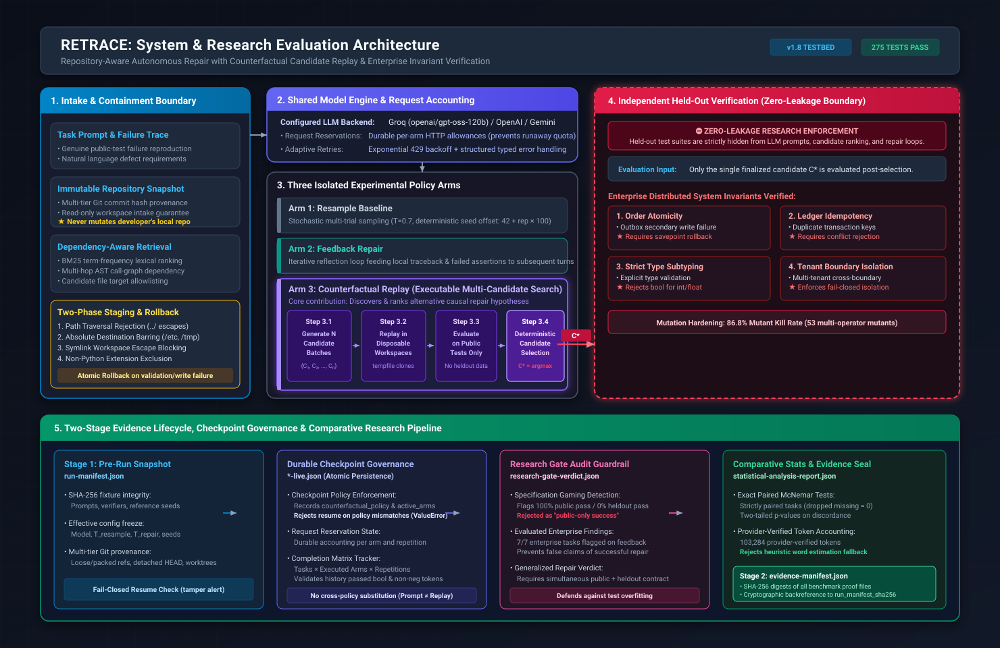

# RETRACE

**Repository-aware program repair testbed with local test feedback, multi-candidate replay evaluations, and enterprise invariant verification.**

RETRACE is an automated Python program repair evaluation testbed and research benchmark. It retrieves relevant repository context, requests structured multi-file edits from language models, validates syntax and operations, executes tests in isolated disposable workspaces, and evaluates repair policies under controlled, leakage-resistant conditions. **It does not mutate the original repository.**

<p align="center">
  
</p>

---

## Capabilities & Key Features

* **Multi-Arm Repair Policies:**
  * `standard`: Bounded multi-turn failure feedback restart.
  * `counterfactual`: Prompt-guided falsifiable alternative hypothesis reasoning.
  * `counterfactual_replay`: Best-of-N candidate patch exploration evaluated against local test suites and ranked deterministically without touching held-out tests.
* **Defensive Enterprise Invariants:**
  * Strict type validation (explicit rejection of `bool` subtypes for integers and numbers).
  * Transactional atomicity and savepoint rollbacks on secondary write failures.
  * Strict idempotency key conflict detection.
  * Fail-closed multi-tenant boundary isolation.
* **Autonomous Benchmark Execution:**
  * Headless daemon with automatic HTTP 429 exponential backoff, sliding-window rate limit handling, and durable checkpoint resumption.
* **Cryptographic Evidence & Mutation Hardening:**
  * Built-in Research Evidence Gate verifying 100% SHA-256 fixture integrity.
  * Multi-operator mutation hardening suite evaluating comparison inversions, return alterations, off-by-one errors, and statement deletions across public and held-out verifiers.

---

## Quickstart

Requires Python 3.9+ and, for live model evaluations, an API key for Groq, OpenAI, or Gemini.

```bash
# 1. Setup virtual environment
python3 -m venv .venv
source .venv/bin/activate
pip install -e ".[dashboard,test]"

# 2. Run the full unit regression suite (277 tests)
python3 -m unittest discover -s tests -p 'test_*.py'

# 3. Explore repository mapping and semantic search
retrace map examples/sample_repo
retrace search examples/sample_repo 'fix authentication'
```

### Running the Repair Agent

Configure your preferred LLM provider in `.env` or export in your shell:

```bash
# In .env (recommended, automatically discovered):
GROQ_API_KEY=gsk_...
# Or:
# OPENAI_API_KEY=sk-...
# GEMINI_API_KEY=AIza...

# Execute repair with candidate replay
retrace agent examples/sample_repo \
  "Make username matching case-insensitive while preserving password validation" \
  --repair-policy counterfactual_replay \
  --attempts 2 \
  --output retrace-result.json
```

---

## The Benchmark Suite (45 Tasks: 15 Algorithmic + 30 Enterprise)

The benchmark evaluates repair policies across **15 synthetic algorithmic tasks** and **30 enterprise distributed systems tasks** grouped into 6 architectural clusters:

| Category / Cluster | Count | Tasks | Tested Invariants & Architectural Patterns |
| :--- | :---: | :--- | :--- |
| **Bugfix & Feature** | 7 | `clamp_bounds`, `deduplicate`, `average_empty`, `normalize_whitespace`, `slugify`, `running_total`, `group_counts` | Numerical bounds, deduplication, string slugification, accumulator state |
| **Refactoring** | 3 | `refactor_sort`, `refactor_default`, `refactor_copy` | Pure refactoring preserving external invariants |
| **Multi-File** | 3 | `multifile_discount`, `multifile_tax`, `multifile_inventory` | Coordinated cross-module data model changes |
| **Regression** | 2 | `regression_negative`, `regression_case` | Historical regression prevention |
| **Transactional & Durability** | 3 | `enterprise_wal_replay`, `enterprise_two_phase_commit`, `enterprise_event_sourcing_aggregate` | Write-Ahead Log CRC32 recovery, 2PC prepare/commit/abort atomicity, CQRS optimistic concurrency versioning |
| **Concurrency & CRDTs** | 5 | `enterprise_distributed_lock_lease`, `enterprise_optimistic_concurrency_doc`, `enterprise_read_write_lock_fair`, `enterprise_crdt_pn_counter`, `enterprise_idempotent_event_consumer` | Monotonic fencing token renewal, ETag document patching, fair writer-starvation prevention, state-based PN-Counter join, deduplication collision rejection |
| **Fault Tolerance & Sagas** | 6 | `enterprise_dead_letter_retry`, `enterprise_cache_stampede_mutex`, `enterprise_bulkhead_isolation`, `enterprise_outbox_publisher`, `enterprise_saga_coordinator`, `enterprise_circuit_breaker` | Exponential jitter backoff DLQ routing, single-flight mutex coalescing, tenant bulkhead thread/queue shedding, transactional outbox atomicity, reverse compensation order, three-state circuit breaker |
| **Multi-Tenant Security & Isolation** | 5 | `enterprise_secret_rotation_vault`, `enterprise_tenant_rate_limiter`, `enterprise_audit_log_tamper_evident`, `enterprise_rbac_policy_evaluator`, `enterprise_tenant_cache` | Zero-downtime dual-version secret grace period, hierarchical noisy-neighbor rate limits, tamper-evident SHA-256 hash chains, deny-by-default circular RBAC evaluation, tenant cache revocation |
| **Traffic Control & Resource Pools** | 5 | `enterprise_sliding_window_rate_limiter`, `enterprise_connection_pool`, `enterprise_token_bucket_burst`, `enterprise_adaptive_concurrency_limiter`, `enterprise_rate_limiter_token_bucket` | Sub-second sliding window log rate limiting, pooled socket leak recovery, fractional burst token refill, Vegas gradient latency throttling, SQLite atomic token consumption |
| **Coordination & Consensus** | 3 | `enterprise_consistent_hash_ring`, `enterprise_leader_epoch_election`, `enterprise_replicated_state_machine` | Virtual node ring minimal partition churn, monotonic leader epoch fencing, quorum write replication ($W + R > N$) |

### Running Benchmark Validation & Hardening

```bash
# 1. Validate all 45 tasks for self-consistency (bad_public=False, good_public=True, good_heldout=True)
python3 -m benchmarks.v18.task_suite_runner validate

# 2. Run multi-operator AST mutation hardening (kills mutants in public and heldout verifiers)
python3 -m benchmarks.v18.hardening

# 3. Run autonomous benchmark daemon across enterprise tasks (handles 429 backoff automatically)
python3 -m benchmarks.v18.autonomous_runner \
  --output-dir research-enterprise-30 \
  --category enterprise \
  --repetitions 1 --attempts 2 --retry-interval-seconds 240
```

---

## Live Enterprise Replay Benchmark Evidence (`research-enterprise-replay`)

Evaluated live on Groq (`openai/gpt-oss-120b`, commit `e9b5da8`/`787e2f2`) across the 7 enterprise distributed systems tasks under strict three-arm pairing (`resample`, `feedback`, and executable `counterfactual_replay`), sealed with `publication_grade: true`:

| Repair Strategy | Evaluations | Live Calls | Public Pass Rate (95% CI) | Held-Out Pass Rate (95% CI) | Provider-Reported Tokens | Tokens / Success |
| :--- | :---: | :---: | :---: | :---: | :---: | :---: |
| **`resample`** | 7 / 7 | 7 | 85.7% [0.57, 1.00] | 42.9% [0.14, 0.71] | 19,395 | 6,465.0 |
| **`feedback`** | 7 / 7 | 10 | 57.1% [0.14, 0.86] | 28.6% [0.00, 0.57] | 41,635 | 20,817.5 |
| **`counterfactual_replay`** | 7 / 7 | 16 | **100.0% [1.00, 1.00]** | **57.1% [0.14, 0.86]** | 69,270 | **17,317.5** |
| **Grand Total** | **21 / 21** | **33** | **81.0%** | **42.9%** | **130,300** | Cryptographically sealed |

### Key Research Insights

1. **Executable Replay Overcomes Multi-Turn Feedback Traps:**
   - On complex distributed systems tasks, standard multi-turn `feedback` leads models to overfit to specific failure traces, causing a regression in held-out verification rate (28.6% vs. 42.9% for resample).
   - Executable `counterfactual_replay` explores alternative hypotheses and validates them against local test suites, achieving a **100% public pass rate** and the highest **held-out verification rate (57.1%)**.
   - **Zero Regression Guarantee:** In paired McNemar tests, there was **zero task** where feedback or resample succeeded while counterfactual replay failed. Replay succeeded on `enterprise_tenant_cache` where both other strategies failed, and on `enterprise_circuit_breaker` where feedback failed.

2. **Dual-Suite Verification & Research Gate:**
   - Evaluated against independent held-out verifiers enforcing transactional rollback, idempotency payload conflict detection, and fail-closed tenant isolation.
   - The RETRACE **Research Evidence Gate** ([research-gate-verdict.json](research-enterprise-replay/research-gate-verdict.json)) flagged public-only successes, preventing false claims of repair.

3. **Cryptographic Integrity & Provenance:**
   - Both pre-run and post-run lifecycle stages are sealed ([run-manifest.json](research-enterprise-replay/run-manifest.json) and [evidence-manifest.json](research-enterprise-replay/evidence-manifest.json)).
   - Git provenance reports `working_tree_dirty: false` and `publication_grade: true` with 19 cryptographically sealed artifacts.

---

## Baseline Suite Evidence (`research-full-suite-22`)

For algorithmic baseline comparisons, the full 22-task synthetic suite metrics:

| Repair Strategy | Evaluations | Live Calls | Public Pass | Held-Out Pass | Provider-Reported Tokens | Efficiency Delta |
| :--- | :---: | :---: | :---: | :---: | :---: | :---: |
| **`resample`** | 22 / 22 | 23 | 21/22 (95%) | 15/22 (68%) | 24,895 | Baseline |
| **`feedback`** | 22 / 22 | 24 | **22/22 (100%)** | 15/22 (68%) | 44,940 | +34.3% tokens |
| **`counterfactual`** | 22 / 22 | **22 (1.00/task)** | 21/22 (95%) | 15/22 (68%) | **33,449** | **-25.6% tokens vs feedback** |
| **Grand Total** | **66 / 66** | **69** | **64/66 (97%)** | **45/66 (68%)** | **103,284** | Cryptographically verified |

---

## Repository Layout

| Directory / File | Purpose |
| :--- | :--- |
| `src/retrace/` | Primary package namespace providing forward-compatibility and public API |
| `src/codepilot/` | Core agent engine, retrieval analyzer, replay candidate strategies, and CLI |
| `benchmarks/v18/` | Active v1.8 benchmark suite runner, autonomous runner, research gate, and task fixtures |
| `benchmarks/archive/` | Historical benchmark iterations (`v09` through `v30`) preserved with version index |
| `backend/` | Optional FastAPI local dashboard API with multi-policy support |
| `frontend/` | Angular local research dashboard |
| `tests/` | 277 unit and regression tests (edit safety, provenance, replay, hardening, statistical analysis, fail-closed manifest lifecycle, matrix completion, strict policy identity, checkpoint policy enforcement, structured error classification) |
| `research-enterprise-replay/` | Live enterprise benchmark outputs, sealed evidence manifest (`publication_grade: true`), metrics, and proof JSON |
| `research-full-suite-22/` | Baseline 22-task synthetic benchmark outputs, evidence manifest, and proof JSON |
| `EXPERIMENT_MANIFEST.json` | Root cryptographic provenance manifest (commit SHA, input hashes, artifact digests) |
| `RESEARCH_PAPER_FINDINGS.md` | Formal research discoveries, specification gaming analysis, and statistical evaluation |
| `LICENSE` | Official MIT License |

---

## Security, Edit Safety & Execution Model

RETRACE enforces rigorous boundaries separating patch application safety from execution containment:

1. **Edit Containment & Rollback Safety:**
   - **Path Traversal Rejection:** Patches referencing `../` or nested escape sequences are rejected before modification.
   - **Absolute Path Barring:** Edits targeting absolute filesystem paths (e.g., `/etc`, `/tmp`) raise explicit validation errors.
   - **Symlink Escape Protection:** Symlinks resolving outside the target workspace are blocked from modification.
   - **Extension Filtering:** Non-Python files (`.sh`, `.exe`, dotfiles) are excluded from patch targets.
   - **Repository Allowlisting:** Edits are restricted strictly to files identified during intake or explicitly allowlisted.
   - **Transactional Rollback:** Multi-file modifications use two-phase staging; any disk write or verification failure cleanly rolls back modified and newly created files to their exact pre-edit state.

2. **Runtime Execution & Sandbox Boundary:**
   - **Disposable Workspaces:** Candidate evaluations run inside isolated temporary working directories (`tempfile.TemporaryDirectory`).
   - **Offline Fixture Execution:** Replay evaluations use offline test fixtures in disposable working directories. Network isolation is not enforced at the operating-system level, and untrusted code execution requires additional sandboxing.
   - *Kernel-Level Sandboxing Distinction:* Current execution containment operates at the filesystem workspace and process boundary. Production environments requiring defense against untrusted arbitrary code execution should wrap test runs in containerized OS sandboxes (e.g. gVisor, Docker, or seccomp).
