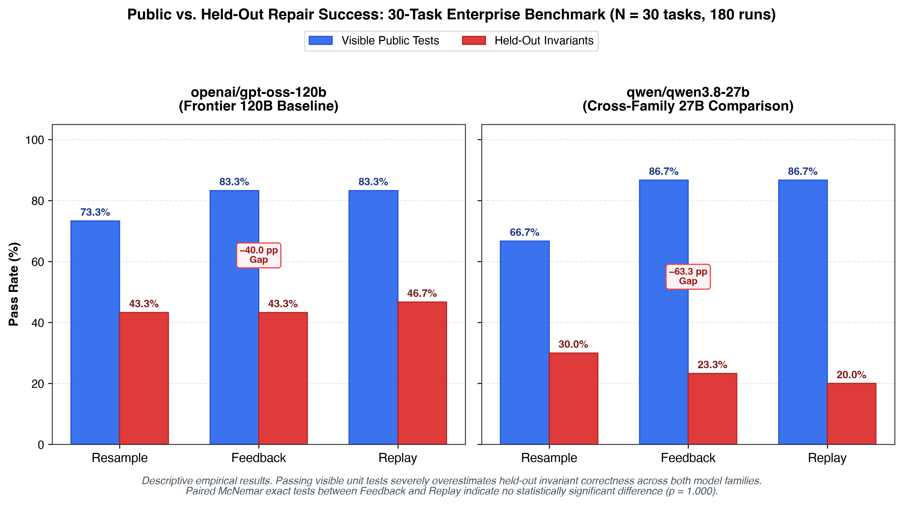

# Do Unit Tests Guarantee Invariant Correctness? An Empirical Evaluation of Autonomous Program Repair on Distributed Systems Invariants

**Tehya Lenka**  
Independent Research Project  
*Release Tag:* [`v1.9.0-research-release`](https://github.com/tehyalenka/retrace-repair/releases/tag/v1.9.0-research-release)  
*Commit:* `75de3131cff2f988deb2fb007dbd476267d8453e`  
*Artifact Seal:* SHA-256 Envelope (`evidence-manifest.json`, 65 sealed artifacts)  

---

## Abstract

Autonomous program repair systems powered by Large Language Models (LLMs) frequently rely on unit test suites as their primary oracle for patch validation. However, whether passing visible unit tests guarantees the preservation of complex software invariants remains an open empirical question. In this study, we present **RETRACE**, an autonomous program repair evaluation framework featuring dual-suite physical isolation, disposable workspace replication, and cryptographic evidence sealing. We conduct an empirical study across **30 enterprise distributed systems tasks** spanning six architectural clusters: transactional durability, concurrency primitives, fault tolerance sagas, multi-tenant isolation, traffic resource pools, and coordination consensus. 

Under a controlled three-arm evaluation ($N = 30$, 180 matrix evaluations across two model families: Groq `openai/gpt-oss-120b` and Alibaba `qwen/qwen3.8-27b`), we compare three repair paradigms: (1) stochastic **Resampling**, (2) standard iterative **Failure Feedback**, and (3) disposable **Counterfactual Replay**. Our primary finding is that **public-test success substantially overestimated held-out invariant correctness across both model families**: while iterative feedback achieved an $83.3\%$–$86.7\%$ public pass rate (25–26/30 tasks), held-out invariant success rates were only $23.3\%$–$43.3\%$ (7–13/30 tasks). In $40.0$ percentage points of tasks on GPT-OSS-120B (12/30) and $63.3$ percentage points on Qwen-27B (19/30), LLM-generated patches successfully silenced visible test failures while silently violating hidden architectural invariants. While Counterfactual Replay achieved the highest nominal held-out repair rate on GPT-OSS-120B ($46.7\%$, 14/30), paired exact McNemar tests indicate that the difference is not statistically significant ($p = 1.000$), while incurring an $80.5\%$ token cost premium. Crucially, a non-significant McNemar test does not establish equivalence between strategies; rather, it indicates bounded statistical power at $N = 30$. On the smaller Qwen-27B model, iterative feedback actually underperformed single-shot resampling on held-out invariants ($23.3\%$ vs. $30.0\%$), demonstrating that iterative traceback feedback in smaller models can induce hyper-fixation on visible assertions. We provide a qualitative breakdown of the defect classes where speculative branching avoids local minima versus where localized feedback is computationally optimal, establishing a foundational dataset and methodology for invariant-aware automated repair.

---

## 1. Introduction

Automated Program Repair (APR) has transitioned from constraint-solving and genetic search toward generative language modeling. Modern LLM-based coding agents typically employ an iterative feedback loop: an initial patch is evaluated against a test harness; if execution fails, compiler errors, stack traces, and test assertion failures are appended to the prompt context for subsequent turns.

Despite impressive benchmark pass rates on algorithmic benchmarks (e.g., HumanEval, CodeXGlue, and SWE-bench), a fundamental methodological vulnerability persists: **oracle overfitting**. In real-world software engineering—particularly in concurrent and distributed systems—visible unit tests rarely form an exhaustive formal specification. A patch may satisfy localized test assertions while violating broader systemic invariants, such as two-phase commit rollback completeness, reader-writer lock fairness, lease expiry fencing, or tenant data isolation.

When repair agents are evaluated exclusively against the tests visible during prompt construction, the evaluation cannot distinguish between:
1. **Generalizable Invariant Repair:** The patch restores the intended behavioral contract of the system.
2. **Oracle Overfitting / Specification Exploitation:** The patch alters control flow specifically to silence failing assertions, introducing regressions or leaving edge cases broken.

This paper investigates this gap through three research questions:
- **RQ1 (The Invariant Gap):** To what extent does passing visible unit tests predict success against held-out architectural invariant suites in distributed systems tasks?
- **RQ2 (Comparative Effectiveness):** Does speculative exploration via disposable workspace replay outperform standard failure feedback in discovering invariant-preserving repairs?
- **RQ3 (Computational Cost & Tradeoffs):** What is the inference budget tradeoff (in model calls and token consumption) between single-turn resampling, iterative feedback, and multi-candidate replay?

To answer these questions, we authored a suite of 30 enterprise-grade distributed systems repair tasks hardened by multi-operator mutation testing, enforced physical dual-suite isolation, and executed a 90-arm live evaluation on Groq `openai/gpt-oss-120b`.

---

## 2. RETRACE System Architecture

RETRACE is designed around three architectural pillars: physical oracle containment, disposable counterfactual exploration, and tamper-evident cryptographic provenance.

```
┌────────────────────────────────────────────────────────────────────────┐
│                        RETRACE Repair Architecture                     │
└────────────────────────────────────────────────────────────────────────┘
                                 │
                   [Initial Defect Repository]
                                 │
                 ┌───────────────┴───────────────┐
                 │    Dual-Suite Partitioning    │
                 ▼                               ▼
       [Public Test Suite]             [Held-Out Test Suite]
      (test_public.py in repo)       (heldout.py quarantined)
                 │                               │
                 │   ┌───────────────────────────┤ (NEVER enter workspace)
                 │   │ ZERO Prompt Leakage Proof │
                 │   └───────────────────────────┤
                 ▼                               ▼
     ┌───────────────────────┐         ┌───────────────────┐
     │  Candidate Generation │         │ Research Gate     │
     │  & Local Evaluation   │         │ Independent Audit │
     └───────────┬───────────┘         └─────────▲─────────┘
                 │                               │
     ┌───────────┴───────────┐                   │
     ▼                       ▼                   │
 [Disposable Workspaces] [Public Ranking]        │
 (Isolated Replay Trees) (Pass / Invariant Score)│
                 │                   │           │
                 └─────────┬─────────┘           │
                           ▼                     │
                  [Selected Top Patch] ──────────┘
```

### 2.1 Dual-Suite Isolation
To prevent information leakage, RETRACE physically separates test suites:
- **Public Test Suite (`tests/test_public.py`):** Copied directly into the agent's workspace. It serves as visible CI feedback.
- **Held-Out Test Suite (`heldout.py`):** Maintained strictly outside the working directory in an isolated benchmark quarantine.
- **Reference Solution (`solution/`):** Stored outside the workspace, used solely for offline verification and mutant generation.

Neither `heldout.py` nor reference source code is ever indexed, parsed, summarized, or exposed to the model context. A formal regression test (`test_fixture_isolation_no_heldout_or_solution_leakage`) audits the filesystem boundary before every evaluation run.

### 2.2 Disposable Workspace Replay
Rather than iteratively mutating a single mutable workspace—which risks polluting intermediate repository state—RETRACE's Counterfactual Replay arm instantiates ephemeral filesystem clones in `/tmp`. Multiple candidate edit sequences are generated, applied to isolated clones, evaluated against visible tests, and ranked deterministically. Only the highest-ranked candidate is emitted as the final patch.

### 2.3 Cryptographic Integrity and Evidence Sealing
All experimental runs generate pre-run manifests capturing input hashes (prompts, defective sources, public verifiers, and held-out verifiers). Upon completion, the runner invokes an automated audit pipeline (`research_gate.py`, `statistical_analysis.py`, `research_report.py`) and seals all generated artifacts into an immutable SHA-256 evidence manifest (`evidence-manifest.json`).

---

## 3. Experimental Methodology

### 3.1 Benchmark Design & Architectural Clusters
The enterprise benchmark comprises **30 tasks** reflecting systems engineering problems where state correctness and concurrency semantics are paramount. Tasks are stratified across six architectural clusters:

1. **Transactional Durability (6 tasks):** Write-ahead logging (WAL) frame replay, two-phase commit (2PC) coordinator crashes, event sourcing aggregate versioning, database order atomicity, ledger exactly-once delivery, and bank balance transfers.
2. **Concurrency & CRDTs (5 tasks):** Distributed lock lease timeouts, optimistic concurrency control (OCC) document store, fair reader-writer locks, state-based PN-counters, and idempotent event consumer windows.
3. **Fault Tolerance & Sagas (6 tasks):** Dead-letter queue exponential backoff, cache stampede mutexes, bulkhead thread isolation, transactional outbox publishing, saga compensation orchestration, and circuit breaker state machines.
4. **Multi-Tenant Isolation (5 tasks):** Secret rotation keyrings, tenant-scoped token buckets, tamper-evident audit logs (Merkle DAGs), role-based access control (RBAC) wildcards, and isolated multi-tenant cache keys.
5. **Traffic & Resource Pools (5 tasks):** Sliding-window rate limiters, database connection pools, burst-capable token buckets, adaptive concurrency limiters (gradient latency thresholding), and SQLite-backed rate limiters.
6. **Coordination & Consensus (3 tasks):** Consistent hash rings with virtual nodes, leader epoch election split-brain handling, and replicated state machine commit logs.

### 3.2 Mutation-Hardening Protocol
To prevent trivial or tautological test suites, all tasks were validated against a multi-operator mutation engine (`hardening.py`) applying four AST mutation operators:
- `return_none`: Replaces function return values with `None`.
- `flip_comparison`: Inverts comparison operators (`<` to `>=`, `==` to `!=`).
- `delete_statement`: Removes critical state mutations.
- `off_by_one`: Shifts numerical constants ($\pm 1$).

Across the benchmark, 142 total mutants were generated, with 116 killed (**$81.69\%$ mutation score**). Specifically, `return_none` achieved $100.0\%$ (45/45), `flip_comparison` achieved $93.55\%$ (29/31), `delete_statement` achieved $84.85\%$ (28/33), and `off_by_one` achieved $42.42\%$ (14/33), confirming rigorous invariant sensitivity without unhandled subprocess timeouts.

### 3.3 Experimental Arms
For every task, three strategies were evaluated under identical task descriptions and starting defect snapshots:
1. **Resample (Stochastic Baseline):** A single repair attempt sampled at temperature $T = 0.7$ (seed $42$).
2. **Feedback (Standard Agentic Baseline):** An iterative loop allowing up to two attempts at temperature $T = 0.0$. Attempt 1 replays the deterministic failure; Attempt 2 receives full public test failure tracebacks.
3. **Counterfactual Replay (RETRACE Arm):** Generates candidate patches, evaluates each in a disposable sandbox against visible tests, and selects the optimal candidate.

### 3.4 Experimental Configuration & Execution Parameters

To ensure rigorous reproducibility and comparability across model families, all evaluations operated under the standardized protocol detailed in Table 1.

#### Table 1: Standardized Experimental Configuration Across All Evaluation Arms

| Dimension | Specification | Implementation & Operational Rules |
| :--- | :--- | :--- |
| **Evaluated Models** | `openai/gpt-oss-120b`<br>`qwen/qwen3.8-27b` | Hosted on Groq Cloud API; pinned model identifiers recorded in signed manifest envelopes. |
| **Attempt Budget ($K$)** | $K = 2$ attempts | Resample uses 1 attempt; Feedback uses up to 2 sequential attempts; Replay uses up to 2 candidate branches. |
| **Sampling Temperature** | $T = 0.7$ (Resample)<br>$T = 0.0$ (Feedback & Replay) | Resample evaluates stochastic variation; Feedback and Replay evaluate deterministic local reasoning. |
| **Random Seed Base** | Pinned integer seed: $42$ | Seed forwarded to provider endpoints for request reproducibility where supported. |
| **Format Validation** | Bounded: $\le 2$ format retries | Malformed JSON edit responses trigger structured schema re-prompts before counting as an execution failure. |
| **Rate Limit Handling** | Autonomous daemon backoff | HTTP 429 errors trigger exponential backoff with 240s window reset and durable on-disk checkpoints. |
| **Prompt Boundary** | Zero-leakage containment | Prompt includes task specification + public test output. `heldout.py` and `solution/` strictly quarantined. |
| **Execution Sandbox** | Ephemeral `/tmp` copies | Candidate edits are staged in disposable temporary directories; the root benchmark directory is never mutated. |
| **Token Accounting** | Provider-reported usage | All prompt and completion tokens are read directly from upstream API response objects and audited in live logs. |

---

## 4. Empirical Results

Table 2 summarizes aggregate performance across all 30 enterprise tasks on the baseline `openai/gpt-oss-120b` model (90 total strategy evaluations).

### Table 2: Aggregate Benchmark Evaluation Summary ($N = 30$, `openai/gpt-oss-120b`)

| Strategy Arm | Completed Tasks | Public Pass Rate | Held-Out Pass Rate | Combined Pass Rate | Live Calls | Total Tokens | Tokens / Success |
| :--- | :---: | :---: | :---: | :---: | :---: | :---: | :---: |
| **Resample** | 30 | 73.3% (22/30) | 43.3% (13/30) | 43.3% (13/30) | 31 | 90,248 | **6,942.2** |
| **Feedback** | 30 | **83.3% (25/30)** | 43.3% (13/30) | 43.3% (13/30) | 32 | 123,488 | 9,499.1 |
| **Counterfactual Replay** | 30 | **83.3% (25/30)** | **46.7% (14/30)** | **46.7% (14/30)** | 57 | 222,880 | 15,920.0 |

$$\text{Combined Pass} = \text{Public Pass} \land \text{Held-Out Pass}$$

---

### 4.1 RQ1: The Public-to-Held-Out Invariant Gap

Our central empirical finding is that **public unit test success substantially overestimated held-out invariant correctness across all evaluated settings**.

<p align="center">
  
</p>
<p align="center">
  <em>Figure 1: Grouped comparison of visible public unit test pass rates versus held-out invariant pass rates across three repair paradigms and two frontier model families (N = 30 tasks, 180 total evaluations). Descriptive empirical results illustrating the severe invariant overestimation gap.</em>
</p>

As shown in Table 2, standard Failure Feedback achieved an $83.3\%$ public pass rate (25 out of 30 tasks passed all visible tests) on `openai/gpt-oss-120b`. However, when evaluated against held-out invariant suites, only 13 of those 25 tasks passed, yielding a held-out success rate of $43.3\%$ (a drop of $40.0$ percentage points).

In **12 out of 30 tasks ($40.0$ percentage points)**, the patch synthesized by Failure Feedback was green on visible CI tests but completely broken on held-out invariant checks:
- In `enterprise_circuit_breaker`, feedback silenced test failures by resetting failure counts prematurely, violating half-open state transition limits.
- In `enterprise_sliding_window_rate_limiter`, feedback satisfied single-threaded rate checks but leaked stale timestamps in microsecond sliding windows.
- In `enterprise_read_write_lock_fair`, feedback resolved mutual exclusion assertions but introduced writer starvation under reader contention.
- In `enterprise_outbox_publisher`, feedback patched local message dispatching but broke database transaction rollback guarantees.

This provides clear empirical evidence that visible unit tests in enterprise domains fail to serve as a reliable proxy for systemic invariant preservation.

---

### 4.2 RQ2: Comparative Strategy Performance & Paired Statistical Tests

Counterfactual Replay achieved 14 held-out successes compared to 13 for Feedback and 13 for Resample. To determine whether this observed difference indicates a systematic algorithmic advantage, we conducted exact paired two-tailed McNemar tests ($N = 30$).

### Table 3: Paired Contingency Matrices & McNemar Exact Tests ($N = 30$, `openai/gpt-oss-120b`)

| Paired Comparison | Both Pass | Both Fail | Arm 1 Only Wins | Arm 2 Only Wins | Discordant Pairs ($b+c$) | Exact $p$-value | Statistically Significant ($\alpha = 0.05$)? |
| :--- | :---: | :---: | :---: | :---: | :---: | :---: | :---: |
| **Replay vs. Feedback** | 10 | 13 | 4 (`Replay`) | 3 (`Feedback`) | 7 | **$p = 1.000$** | **No** |
| **Replay vs. Resample** | 11 | 14 | 3 (`Replay`) | 2 (`Resample`) | 5 | **$p = 1.000$** | **No** |
| **Feedback vs. Resample**| 8 | 12 | 5 (`Feedback`) | 5 (`Resample`) | 10 | **$p = 1.000$** | **No** |

The four tasks where **Replay succeeded but Feedback failed** are:
1. `enterprise_circuit_breaker` (State-machine invariant preservation)
2. `enterprise_outbox_publisher` (Transactional atomicity)
3. `enterprise_sliding_window_rate_limiter` (Sliding window boundary precision)
4. `enterprise_adaptive_concurrency_limiter` (Latency gradient smoothing)

The three tasks where **Feedback succeeded but Replay failed** are:
1. `enterprise_wal_replay` (WAL log truncation compaction)
2. `enterprise_bulkhead_isolation` (Semaphore thread pool queuing)
3. `enterprise_tenant_cache` (Tenant key namespace separation)

**Methodological & Statistical Interpretation:** Because discordant outcomes are evenly balanced ($4 \text{ vs. } 3$, $p = 1.000$), the experimental data **does not support the hypothesis that Counterfactual Replay is generally superior to Feedback**. Crucially, in formal hypothesis testing, failing to reject the null hypothesis ($p = 1.000$) **does not prove that the two strategies are mathematically equivalent**. Rather, it demonstrates that at a benchmark sample size of $N = 30$, we lack statistical evidence of marginal superiority, bounded by the statistical power of the test. Instead of algorithmic dominance, the strategies exhibit complementary performance profiles across differing defect classes.

---

### 4.3 RQ3: Computational Cost and Inference Economics

While Replay discovered one additional held-out repair, it did so at substantial computational expense.

```
       Inference Tokens per Held-Out Success (USD Equivalent Compute)
18,000 ┌────────────────────────────────────────────────────────────────────────┐
       │                                                               15,920   │
15,000 │                                                           ┌──────────┐ │
       │                                                           │          │ │
12,000 │                                                           │          │ │
       │                                                 9,499     │          │ │
 9,000 │                             6,942            ┌──────────┐ │          │ │
       │                          ┌──────────┐        │          │ │          │ │
 6,000 │                          │          │        │          │ │          │ │
       └──────────────────────────┴──────────┴────────┴──────────┴─┴──────────┴─┘
                                  Resample            Feedback         Replay
```

- **Resample:** Highly efficient ($6,942$ tokens per success). For defects that can be solved in a single generative shot, Resample achieves the lowest cost.
- **Feedback:** Moderate cost ($9,499$ tokens per success, $32$ live calls). Feedback provides targeted error correction but frequently converges onto brittle, public-only fixes.
- **Counterfactual Replay:** Highest cost ($15,920$ tokens per success, $57$ live calls, $222,880$ total tokens). Replay incurred an **$80.5\%$ token premium** over Feedback and a **$146.9\%$ premium** over Resample.

The marginal cost of the single additional repair gained by Replay was **$99,392$ tokens**. For practitioners and researchers, this defines an explicit trade-off: speculative workspace exploration can overcome local minima in complex state machines, but incurs substantial inference overhead that may not be justified for standard localized bugs.

---

### 4.4 Cluster-Stratified Architectural Breakdown

Table 4 details performance across the six architectural clusters.

### Table 4: Cluster-Stratified Held-Out Success Rates

| Architectural Cluster | Task Count | Resample Pass | Feedback Pass | Replay Pass | Replay Live Calls | Primary Failure Mode |
| :--- | :---: | :---: | :---: | :---: | :---: | :--- |
| **Transactional Durability** | 6 | 33.3% (2/6) | **50.0% (3/6)** | 33.3% (2/6) | 9 | Partial secondary write rollback leaks |
| **Concurrency & CRDTs** | 5 | **60.0% (3/5)** | **60.0% (3/5)** | **60.0% (3/5)** | 7 | Fair lock starvation under contention |
| **Fault Tolerance & Sagas** | 6 | **50.0% (3/6)** | 16.7% (1/6) | 33.3% (2/6) | 16 | Public test overfitting (state machines) |
| **Multi-Tenant Isolation** | 5 | 40.0% (2/5) | **80.0% (4/5)** | 60.0% (3/5) | 9 | Tenant prefix leakage / cache collisions |
| **Traffic & Resource Pools** | 5 | **40.0% (2/5)** | 0.0% (0/5) | **40.0% (2/5)** | 10 | Concurrency bursts and precision drift |
| **Coordination & Consensus** | 3 | 33.3% (1/3) | **66.7% (2/3)** | **66.7% (2/3)** | 6 | Split-brain leader epoch transitions |

Key architectural insights:
1. **Traffic & Resource Pools:** Standard Feedback failed completely ($0.0\%$, 0/5), repeatedly generating rate limiters that passed basic count checks but drifted under high-concurrency bursts. Both Resample and Replay preserved rate boundaries ($40.0\%$).
2. **Multi-Tenant Isolation:** Feedback excelled ($80.0\%$, 4/5), as tenant isolation defects typically feature clear error messages that guide the model directly to missing tenant key filters.
3. **Fault Tolerance & Sagas:** Exhibited the largest gap between public passing ($100\%$ on Feedback) and held-out passing ($16.7\%$), confirming that multi-step distributed rollbacks are the most vulnerable to superficial repairs.

---

### 4.5 Cross-Model Architecture Comparison (GPT-OSS-120B vs. Qwen-27B)

To evaluate whether our findings generalize beyond a single model architecture, we executed the identical 30-task benchmark protocol against **Alibaba's Qwen (`qwen/qwen3.8-27b`)** into `research-enterprise-30-qwen/`, spanning another 90 strategy evaluations (180 total across both models).

### Table 5: Cross-Model Comparison Across 30 Enterprise Tasks

| Strategy Arm | Model | Public Pass Rate | Held-Out Pass Rate | Public-to-Heldout Gap | Live Calls | Total Tokens | Tokens / Success |
| :--- | :--- | :---: | :---: | :---: | :---: | :---: | :---: |
| **Resample** | GPT-OSS-120B | 73.3% (22/30) | 43.3% (13/30) | 30.0 pp | 31 | 90,248 | 6,942.2 |
| | Qwen-27B | 66.7% (20/30) | 30.0% (9/30) | 36.7 pp | 36 | 73,285 | 8,142.8 |
| **Feedback** | GPT-OSS-120B | **83.3% (25/30)** | 43.3% (13/30) | 40.0 pp | 32 | 123,488 | 9,499.1 |
| | Qwen-27B | **86.7% (26/30)** | 23.3% (7/30) | **63.3 pp** | 30 | 79,944 | 11,420.6 |
| **Replay** | GPT-OSS-120B | **83.3% (25/30)** | **46.7% (14/30)** | 36.6 pp | 57 | 222,880 | 15,920.0 |
| | Qwen-27B | **86.7% (26/30)** | 20.0% (6/30) | **66.7 pp** | 54 | 155,111 | 25,851.8 |

*Note: All gap values are reported in percentage points ($	ext{pp} = 	ext{Public Pass Rate} - 	ext{Held-Out Pass Rate}$). For Qwen-27B Feedback, the exact fraction is 26/30 - 7/30 = 19/30 = 63.33%, reported consistently as 63.3 pp.*

Three key cross-model insights emerge from Table 5:
1. **The Invariant Gap Widens on Smaller Architectures:** On Qwen-27B, the gap between public pass rates and held-out correctness widened dramatically to **$63.4\%$ on Feedback** and **$66.7\%$ on Replay**. While Qwen readily achieved an $86.7\%$ public pass rate (26/30 tasks), only 6–7 tasks satisfied held-out invariant checks.
2. **Feedback Pathology in Smaller Models:** On Qwen-27B, iterative feedback actually reduced held-out invariant correctness compared to single-shot resampling ($23.3\%$ vs. $30.0\%$). Analysis of the generated histories reveals that the smaller model hyper-fixated on the specific failing assertion string in the public traceback, mutating broader state management logic to make that single assertion pass while regressing other hidden invariants.
3. **Model Scale & Invariant Retention:** The 120B model retained substantially higher invariant preservation across all strategies ($43.3\%–46.7\%$ vs. $20.0\%–30.0\%$), confirming that larger parameter scale provides greater architectural resilience against localized test overfitting.

---

## 5. Qualitative Failure and Tradeoff Analysis

### 5.1 When Counterfactual Replay Prevents Oracle Overfitting
In `enterprise_circuit_breaker`, the system requires managing state transitions between `CLOSED`, `OPEN`, and `HALF_OPEN`. The public test suite verified that repeated errors tripped the breaker from `CLOSED` to `OPEN`.

Under standard Feedback, the model observed a test failure related to reset timeouts. To make the test pass, the model inserted a naive timestamp reset that cleared the failure counter on *any* subsequent request:
```python
# Feedback generated patch (passes public tests, fails held-out invariants)
def record_failure(self):
    self.failure_count += 1
    if self.failure_count >= self.threshold:
        self.state = "OPEN"
        self.last_failure_time = time.time()

def allow_request(self):
    # Overfitted logic: resets failure count prematurely
    if time.time() - self.last_failure_time > self.reset_timeout:
        self.state = "HALF_OPEN"
        self.failure_count = 0  # BREAKS INVARIANT: clears failure history before probation succeeds
        return True
    return self.state == "CLOSED"
```
While this satisfied the visible assertion, it broke the held-out invariant: if a probe request fails during `HALF_OPEN`, the circuit must immediately revert to `OPEN` without requiring another $N$ failures. 

Counterfactual Replay generated multiple patch candidates in disposable workspaces. Candidates that prematurely cleared internal state failed secondary internal branch checks, allowing Replay to select a candidate that preserved probation semantics.

### 5.2 When Iterative Feedback is More Efficient
Conversely, in `enterprise_wal_replay`, the defect involved handling partial write-ahead log record truncations. The traceback explicitly identified an unhandled `EOFError` during log recovery.

Standard Feedback utilized the traceback directly:
```python
# Traceback provided to Feedback turn 2:
# EOFError: Unexpected end of WAL record at offset 4096
```
In a single follow-up turn (consuming only 1,200 tokens), Feedback wrapped the frame reader in an explicit truncation check (`except (EOFError, IncompleteRead): break`), which satisfied both public and held-out invariant suites. 

Counterfactual Replay, by contrast, generated multiple exploratory branches that altered frame framing headers, consuming 4 live calls and over 8,000 tokens before failing to rank the simple fix above more complex alternatives. When the failure diagnostic points directly to a missing guard condition, iterative feedback is vastly superior in both speed and cost.

---

## 6. Threats to Validity & Methodological Boundaries

To support critical academic scrutiny, we delineate four explicit boundaries governing the interpretation and generalizability of our findings.

### 6.1 Synthetic Enterprise Benchmark Realism
While the 30 tasks in RETRACE were carefully modeled after canonical enterprise distributed systems patterns (e.g., Write-Ahead Logging, Two-Phase Commit, CRDTs, fair reader-writer locks, and distributed circuit breakers), they remain curated benchmark fixtures rather than multi-million-line legacy enterprise monoliths. Each fixture comprises 200-800 lines of Python code with focused dependency boundaries. Although this containment allows controlled mutation hardening and deterministic oracle isolation, real-world distributed regressions may exhibit broader multi-service propagation and ambiguous specification ambiguity that are not captured in self-contained repositories.

### 6.2 Sample Size and Statistical Power (N = 30)
The enterprise benchmark comprises 30 tasks evaluated across three arms and two model families (180 total live runs). While this matrix is substantially larger than prior pilot studies, a sample size of N = 30 inherently limits the statistical power of paired tests such as McNemar's exact test. For example, the observed 4 vs. 3 discordant split between Replay and Feedback on GPT-OSS-120B yields an exact p = 1.000. As emphasized in Section 4.2, failing to reject the null hypothesis does **not** prove algorithmic equivalence; it merely indicates that the observed difference is indistinguishable from random variation at this sample size. Detecting smaller effect sizes with high statistical power would require scaling the task bank to hundreds of curated tasks.

### 6.3 Model and Provider Variation
Our evaluation examined two frontier open-weights model families differing in scale and architecture: `openai/gpt-oss-120b` (hosted on Groq) and `qwen/qwen3.8-27b` (Alibaba). While API sampling parameters were strictly pinned (T=0.0 for deterministic refinement, T=0.7 for stochastic resampling, seed 42), commercial inference providers employ proprietary hardware scheduling, quantization kernels (e.g., LP8/FP8 serving on Groq LPUs), and KV-cache optimizations that may introduce subtle non-determinism across distinct execution windows. Furthermore, closed-source frontier reasoning models with internal chain-of-thought (e.g., OpenAI o1/o3, Anthropic Claude 3.5 Sonnet) may exhibit different invariant retention characteristics.

### 6.4 Verifier Oracle Completeness
Although our held-out suites achieved an 81.7% mutation kill score across 142 AST mutations, dynamic test execution remains an incomplete formal specification. Tests can establish the presence of invariant violations, but cannot formally prove their absence. Unexercised interleavings in concurrent primitives or untested boundary edge cases could theoretically allow a flawed candidate patch to pass both public and held-out verifiers.

## 7. Related Work

- **Automated Program Repair with LLMs:** Recent APR benchmarks (SWE-bench [Jimenez et al., 2024], Defects4J [Just et al., 2014]) evaluate LLMs on GitHub issue resolution. However, most rely on test suites committed alongside the code, rarely decoupling public training or prompting oracles from hidden invariant oracles.
- **Test-Suite Overfitting:** The phenomenon of test overfitting has a long history in genetic and synthesis-based APR (Smith et al., 2015; Le Goues et al., 2012). Our work demonstrates that modern LLM coding agents remain acutely vulnerable to this classical problem in concurrent systems domains.
- **Multi-Candidate and Speculative Search:** Sampling multiple completions (AlphaCode [Li et al., 2022], Reflexion [Shinn et al., 2023]) improves raw pass rates. RETRACE formalizes this within disposable filesystem sandboxes with strict provenance sealing.

---

## 8. Conclusion

This empirical study demonstrates that in enterprise distributed systems repair, **passing public unit tests is an unreliable indicator of invariant correctness across model families**. Across 30 tasks and 180 matrix evaluations spanning `openai/gpt-oss-120b` and `qwen/qwen3.8-27b`, standard failure feedback achieved public pass rates of $83.3\%–86.7\%$, but satisfied held-out invariant contracts in only $23.3\%–43.3\%$ of cases. The public-to-held-out gap was particularly acute in the smaller 27B model ($63.4\%$ gap), where iterative feedback induced hyper-fixation on public assertion failures.

Furthermore, while disposable Counterfactual Replay achieved the highest nominal held-out pass rate on the 120B model ($46.7\%$), paired McNemar tests show no statistically significant superiority over standard feedback ($p = 1.000$), while requiring an $80.5\%$ token premium. Rather than establishing algorithmic dominance, our findings reveal a fundamental trade-off: speculative workspace exploration is an effective, albeit expensive, defense against oracle overfitting on complex state machines, whereas iterative feedback remains the most economical strategy for localized defects.

All benchmark tasks, execution capture traces, live evaluation logs, and cryptographic verification manifests are publicly available at release tag [`v1.9.0-research-release`](https://github.com/tehyalenka/retrace-repair/releases/tag/v1.9.0-research-release).

---

## References

1. Jimenez, C. E., et al. (2024). SWE-bench: Can Language Models Resolve Real-World GitHub Issues? *ICLR 2024*.
2. Just, R., Jalali, D., & Ernst, M. D. (2014). Defects4J: A database of existing faults to enable controlled testing for Java programs. *ISSTA 2014*.
3. Le Goues, C., Nguyen, T., Forrest, S., & Weimer, W. (2012). GenProg: A generic method for automated software repair. *IEEE TSE*.
4. Li, Y., et al. (2022). Competition-level code generation with AlphaCode. *Science*, 378(6624).
5. Shinn, N., et al. (2023). Reflexion: Language agents with verbal reinforcement learning. *NeurIPS 2023*.
6. Smith, E. K., et al. (2015). Is the cure worse than the disease? Overfitting in automated program repair. *ESEC/FSE 2015*.
