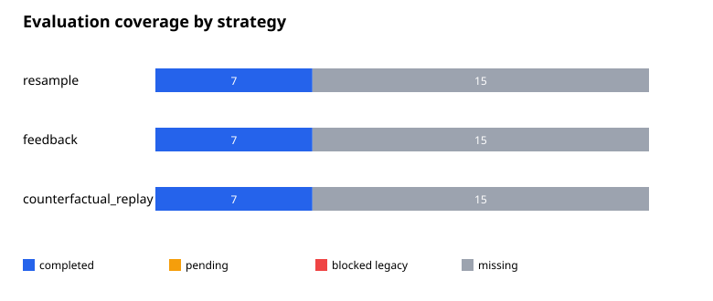

# RETRACE: Synthetic Three-Arm Repair Benchmark

## Evaluation status

This report covers 22 synthetic tasks and 66 strategy evaluations: 21 completed and 0 pending. Pending evaluations are **not** repair failures.

| Strategy | Completed | Pending | Public pass | Heldout pass | Combined pass | Successful model calls |
|---|---:|---:|---:|---:|---:|---:|
| resample | 7 | 0 | 6 | 3 | 3 | 7 |
| feedback | 7 | 0 | 4 | 2 | 2 | 10 |
| counterfactual_replay | 7 | 0 | 7 | 4 | 4 | 16 |



## Resource usage

| Strategy | HTTP known | HTTP unknown | Known HTTP requests | Token-observed evaluations | Observed prompt tokens | Observed completion tokens |
|---|---:|---:|---:|---:|---:|---:|
| resample | 7 | 15 | 16 | 7 | 6671 | 12724 |
| resample | 7 | 15 | 16 | 7 | 6671 | 12724 |
| feedback | 7 | 15 | 19 | 7 | 21405 | 20230 |
| feedback | 7 | 15 | 19 | 7 | 21405 | 20230 |
| counterfactual_replay | 7 | 15 | 36 | 7 | 34238 | 35032 |
| counterfactual_replay | 7 | 15 | 36 | 7 | 34238 | 35032 |

HTTP request counts include durable reservations when available. Reservations conservatively count attempts and do not prove that every request reached the provider.

Observed token counts are not necessarily complete totals, particularly for evaluations resumed from checkpoints. N/A means accounting data is unavailable, not zero.

## Methodology

The three strategies are resampling, standard failure-feedback repair, and counterfactual-guided prompting. Each task begins with a replayed deterministic failed edit. Public test feedback may guide repair; heldout verification is intended for post-repair evaluation. Fixtures are synthetic and not an external benchmark.

Combined pass requires both public and heldout passes. Only completed evaluations are included in pass counts. Paired comparisons include a task/repetition only when both strategies completed.

## Category breakdown

| Category | Strategy | Completed | Pending | Combined pass |
|---|---|---:|---:|---:|
| bugfix | resample | 0 | 0 | 0 |
| bugfix | feedback | 0 | 0 | 0 |
| bugfix | counterfactual_replay | 0 | 0 | 0 |
| feature | resample | 0 | 0 | 0 |
| feature | feedback | 0 | 0 | 0 |
| feature | counterfactual_replay | 0 | 0 | 0 |
| refactor | resample | 0 | 0 | 0 |
| refactor | feedback | 0 | 0 | 0 |
| refactor | counterfactual_replay | 0 | 0 | 0 |
| multifile | resample | 0 | 0 | 0 |
| multifile | feedback | 0 | 0 | 0 |
| multifile | counterfactual_replay | 0 | 0 | 0 |
| regression | resample | 0 | 0 | 0 |
| regression | feedback | 0 | 0 | 0 |
| regression | counterfactual_replay | 0 | 0 | 0 |
| enterprise | resample | 7 | 0 | 3 |
| enterprise | feedback | 7 | 0 | 2 |
| enterprise | counterfactual_replay | 7 | 0 | 4 |

## Paired comparisons (combined pass)

| Comparison | Eligible pairs | Both pass | First only | Second only | Neither |
|---|---:|---:|---:|---:|---:|
| resample vs feedback | 7 | 2 | 1 | 0 | 4 |
| resample vs counterfactual_replay | 7 | 3 | 0 | 1 | 3 |
| feedback vs counterfactual_replay | 7 | 2 | 0 | 2 | 3 |

## Validity and limitations

- 0 completed evaluations contain a recognizable test-discovery infrastructure warning. These outcomes require investigation before any performance claim.
- Provider interruptions and incomplete evaluations may reduce usable paired comparisons. Do not interpret incomplete evaluations as failed repairs.
- A heldout pass alongside a public failure is not counted as combined success.
- Small samples, synthetic fixtures, and a deterministic replayed first failure limit generalizability.
- `live_calls` counts recorded successful model responses, not necessarily all attempted provider requests.
- Never include heldout test contents in model repair prompts.

## Reproduction

```bash
PYTHONPATH=src:. python -m benchmarks.v18.research_report --results-dir v18-task-suite-results --output-dir v18-task-suite-results/research
```

This command reads local JSON only; it does not call an LLM.
